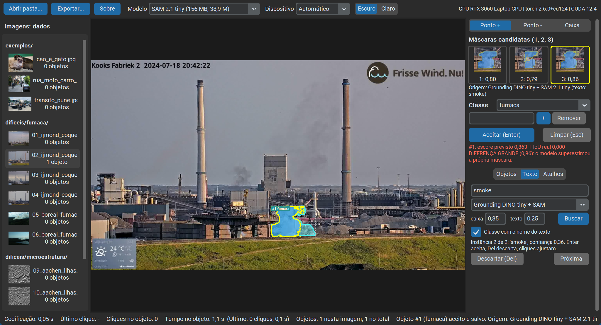

# Aula de SAM: anotação com o Segment Anything Model, do clique ao treino

Aplicativo desktop de anotação de imagens com o SAM (SAM 2.1 e SAM 1, por pontos, caixa ou texto), com medição de tempo em CPU e GPU, comparação entre o escore previsto pelo modelo e a IoU real, e exportação para treinar YOLO-seg, Mask R-CNN e U-Net.

Material da aula sobre o Segment Anything Model na disciplina **Tópicos Complementares de Visão Computacional (PMM.051)**, Programa de Pós-Graduação em Engenharia Metalúrgica e de Materiais (PROPEMM), IFES, em **14/10/2026**. Professor responsável pela aula: **Leonardo Gonçalves Batista**.



*Captura real (Windows 11, janela de 1366x740, RTX 3060): escolha de modelo e dispositivo no topo; à direita, o seletor de ferramenta, as três candidatas, a origem da máscara e a aba Texto. A busca "smoke" achou duas instâncias; a primeira, aceita, tinha escore previsto 0,863 e IoU real 0,000 contra a referência (em vermelho).*

## O que tem aqui

| Pasta ou arquivo | Conteúdo |
| --- | --- |
| `sam_anota/` | o aplicativo (`python -m sam_anota`) |
| `dados/exemplos/` | 3 fotos fáceis (cão e gato, rua, trânsito) |
| `dados/dificeis/` | 10 imagens difíceis com máscara de referência: fumaça, trincas, microestrutura (`POR_QUE_E_DIFICIL.md` explica cada tipo) |
| `dados/fora_do_coco/` | canguru e lingote: objetos fora das 80 classes do COCO |
| `notebooks/` | `01_sam1_guiado.ipynb` (SAM 1: automático, caixa, pontos) e `02_treinar_no_colab.ipynb` (treinar com a exportação) |
| `exemplos/` | YOLO-seg contra SAM lado a lado, e YOLO como prompt do SAM (ultralytics, opcional, AGPL-3.0) |
| `scripts/` | instalação, download de pesos, verificação, teste da interface, medição de tempos, prova de treino |
| `testes/` | testes pytest (exportação, métricas, projeto, dispositivo, modo texto) |
| `docs/` | [INSTALACAO.md](docs/INSTALACAO.md), [EDITORES.md](docs/EDITORES.md) (VS Code, Cursor, Antigravity), captura de tela |
| `.vscode/` | interpretador, F5 "SAM Anota", tarefas de instalação e testes; vale também no Cursor e no Antigravity |
| `requirements*.txt` | dependências com versões fixadas (o torch é instalado pelo `scripts/instalar.py`) |

## Início rápido

Windows, com Python 3.12 (python.org) e git instalados, no PowerShell ou Prompt de Comando:

```powershell
git clone https://github.com/Leonardo-Baptista/aula_SAM_propemm.git
cd aula_SAM_propemm
py -3.12 -m venv .venv
.venv\Scripts\python scripts\instalar.py --opcionais
.venv\Scripts\python -m sam_anota
```

Linux e macOS (não testados):

```bash
git clone https://github.com/Leonardo-Baptista/aula_SAM_propemm.git
cd aula_SAM_propemm
python3.12 -m venv .venv
.venv/bin/python scripts/instalar.py --opcionais
.venv/bin/python -m sam_anota
```

O instalador escolhe o torch CPU ou CUDA 12.4 (se o `nvidia-smi` responder), instala o sam2 do GitHub oficial, os opcionais (SAM 1, modo texto, jupyter), baixa os pesos do SAM 2.1 tiny e do SAM 1 ViT-B com conferência de SHA-256 e termina rodando `scripts/verificar.py` (saída `Ambiente ok.`). Detalhes, instalação manual e erros comuns: [docs/INSTALACAO.md](docs/INSTALACAO.md). Para usar pelo editor: [docs/EDITORES.md](docs/EDITORES.md).

**Testado em 14/10/2026** seguindo este README ao pé da letra, num clone novo, venv novo e sem cache do pip (Windows 11, Python 3.12.10, i7-12700H, rede de cerca de 30 MB/s):

| Instalação | Tempo | Resultado |
| --- | --- | --- |
| CPU (`--cpu --opcionais`) | 4 min 53 s | `Ambiente ok.`; 45 testes passam; teste da interface passa (GPU pedida é recusada com a explicação e o app segue em CPU); notebook 01 roda em 43 s |
| GPU (`--opcionais`, RTX 3060 detectada pelo `nvidia-smi`) | 5 min 48 s | torch 2.6.0+cu124; `Ambiente ok.` (codificação 0,60 s); 45 testes e teste da interface passam na GPU |

## Requisitos de hardware e tempos medidos

Roda em qualquer notebook com 8 GB de RAM, sem GPU. Tempos na imagem `cao_e_gato.jpg` (1600x1200), i7-12700H com 14 threads e RTX 3060 Laptop 6 GB, Windows 11 (`scripts/medir_modelos.py`). Codificação: a primeira (com aquecimento) e a mediana das seguintes; predição: mediana de 5, com 3 candidatas.

| Modelo | Download | Parâmetros | CPU: 1ª codificação | CPU: codificação | CPU: predição | GPU: 1ª codificação | GPU: codificação | GPU: predição |
| --- | --- | --- | --- | --- | --- | --- | --- | --- |
| SAM 2.1 tiny | 156 MB | 38,9 M | 1,06 s | 0,93 s | 0,029 s | 0,27 s | 0,06 s | 0,012 s |
| SAM 2.1 small | 184 MB | 46 M | 1,02 s | 1,08 s | 0,031 s | 0,06 s | 0,06 s | 0,010 s |
| SAM 2.1 base+ | 324 MB | 80,8 M | 1,90 s | 1,94 s | 0,030 s | 0,09 s | 0,09 s | 0,009 s |
| SAM 2.1 large | 898 MB | 224,4 M | 4,72 s | 4,89 s | 0,034 s | 0,21 s | 0,20 s | 0,010 s |
| SAM 1 ViT-B | 375 MB | 91 M | 5,35 s | 5,04 s | 0,038 s | 0,51 s | 0,37 s | 0,007 s |
| SAM 1 ViT-L | 1,25 GB | 308 M | 12,53 s | 12,08 s | 0,042 s | 1,06 s | 0,90 s | 0,006 s |
| SAM 1 ViT-H | 2,56 GB | 636 M | 23,12 s | 19,95 s | 0,036 s | 2,00 s | 1,71 s | 0,012 s |
| Grounding DINO tiny (texto para caixas) | 690 MB | | 5,47 s | 5,17 s | | 0,81 s | 0,31 s | |

CPU com torch 2.14.1 (só CPU); GPU com torch 2.6.0+cu124. Na GPU o SAM 2.1 roda em bfloat16 (como nos exemplos oficiais) e o SAM 1 em float32. Num notebook mais simples, espere de 2 a 4 vezes os tempos de CPU. O que importa para a aula: **codificar a imagem custa segundos; cada clique custa centésimos**, porque o decodificador roda sobre o embedding já calculado.

## Como usar

`python -m sam_anota` abre `dados/` (com `exemplos/` primeiro). Clique no objeto; o SAM propõe três máscaras com o escore que ele prevê; escolha com 1, 2 ou 3, escolha a classe e aceite com Enter. O progresso é salvo a cada objeto em `saidas/` (nada é escrito em `dados/`).

| Ação | Atalho |
| --- | --- |
| Ferramenta Ponto +, Ponto -, Caixa | P, N, C (ou o seletor no painel) |
| Ponto da ferramenta | clique esquerdo |
| Ponto negativo, em qualquer ferramenta | clique direito |
| Caixa, em qualquer ferramenta | arrastar com o botão esquerdo (uma caixa por objeto, somada aos pontos) |
| Escolher candidata | 1, 2, 3 (a de maior escore vem escolhida) |
| Aceitar objeto | Enter |
| Descartar instância do modo texto | Del |
| Limpar o prompt | Esc |
| Desfazer | Ctrl+Z |
| Imagem anterior, próxima | PgUp, PgDn |
| Concluir e ir à próxima pendente | Ctrl+Enter |
| Exportar para treino | Ctrl+E |
| Reler a pasta | F5 |

* **Modelos**: combo no topo com tamanho e parâmetros. SAM 2.1 tiny, small, base+, large; SAM 1 ViT-B, ViT-L, ViT-H (com `--sam1`). Peso que falta é baixado na hora, com barra e SHA-256. Trocar de modelo limpa o cache de embeddings.
* **Dispositivo**: Automático, CPU, GPU (CUDA), GPU (MPS) no Mac. Pedir GPU sem GPU utilizável não quebra: o app explica o motivo e o comando para resolver, e segue em CPU. A barra mostra o dispositivo efetivo, a placa e as versões.
* **Modo texto** (aba Texto, com `--texto`): escreva o conceito em inglês ("smoke", "car"). O Grounding DINO tiny acha caixas e cada caixa vira prompt do SAM escolhido; cada instância é revisada (Enter aceita, Del descarta, cliques ajustam), e a classe de mesmo nome é escolhida sozinha (smoke vira fumaca). O SAM 3 (transformers, `facebook/sam3`) é opcional e exige pedido de acesso aos pesos no Hugging Face: sem acesso, o app explica os passos e oferece o Grounding DINO. A inferência do SAM 3 não foi testada (sem acesso aprovado nesta máquina).
* **Origem de cada máscara**: cada objeto guarda de qual modelo veio ("SAM 2.1 tiny (cliques)", "Grounding DINO tiny + SAM 2.1 tiny (texto: smoke)"), na tela, no CSV e no COCO.
* **Avaliação**: com `<nome>_ref.png` ao lado da imagem (as difíceis têm), o app mostra a IoU real ao lado do escore previsto, em vermelho quando a diferença passa de 0,15, e grava um relatório (CSV e resumo) por sessão em `saidas/<pasta>/relatorios/`.
* **Exportação para treino** (Ctrl+E): YOLO-seg (Ultralytics YOLO11 e YOLO26), COCO de instâncias (Mask R-CNN no torchvision, Detectron2, MMDetection) e máscaras semânticas PNG (U-Net, DeepLabV3, SegFormer), com divisão treino e validação por imagem e semente fixa. Cada formato traz `README_TREINO.md` e, no COCO e na semântica, um script de treino pronto. Objetos com furo ou finos (trincas) vão em RLE no COCO; na semântica, onde objetos se sobrepõem, o último aceito vence. Foi provado com treino de verdade (YOLO11n-seg, YOLO26n-seg, Mask R-CNN v2 e U-Net) e com o pycocotools (`annToMask` igual à máscara exportada em todas as anotações).

## Atividade da aula

1. Abra o aplicativo e anote o tempo de codificação da primeira imagem: é o custo do codificador no seu notebook. Troque para SAM 2.1 small ou base+ e compare.
2. **Fáceis** (`exemplos/`): anote os objetos das 3 fotos. Comece cada objeto com **um clique** e observe as três candidatas: a que o SAM ranqueia melhor é a que você queria? Corrija com Ponto - ou com uma caixa.
3. **Difíceis** (`dificeis/`): anote o objeto de cada imagem. Ao aceitar, compare o **escore previsto** com a **IoU real**.
4. **O caso da fumaça**: com um clique no centro da pluma, o SAM 2.1 tiny previu, para a candidata de maior escore, entre 0,79 e 0,99 em quatro das seis imagens de fumaça (01, 02, 03 e 06), mas a IoU real contra a referência ficou entre 0,03 e 0,23. Fumaça é semitransparente e não tem borda; o SAM encaixa um contorno onde não há. O escore previsto mede a confiança do modelo na própria máscara, não o acerto.
5. Se o modo texto estiver instalado, repita uma difícil com "smoke" ou "crack" e compare com os cliques.
6. Exporte (Ctrl+E) e abra `saidas/dados/relatorios/sessao_..._resumo.md`. Discuta em dupla, com os números: em quais imagens o escore foi otimista demais e o que elas têm em comum; quantos cliques custou cada objeto difícil contra os fáceis; o escore previsto serve para decidir sozinho se uma máscara está boa?

## Notebooks

| Notebook | Colab |
| --- | --- |
| `01_sam1_guiado.ipynb`: geração automática, caixa e pontos com o SAM 1 ViT-B (roda em CPU: cerca de 1 min, testado) | [](https://colab.research.google.com/github/Leonardo-Baptista/aula_SAM_propemm/blob/main/notebooks/01_sam1_guiado.ipynb) |
| `02_treinar_no_colab.ipynb`: envie o zip da exportação e treine YOLO-seg, Mask R-CNN ou U-Net na GPU do Colab | [](https://colab.research.google.com/github/Leonardo-Baptista/aula_SAM_propemm/blob/main/notebooks/02_treinar_no_colab.ipynb) |

No computador, abra com o kernel do `.venv` (instale com `--notebooks` ou `--opcionais`).

## Exemplos com YOLO

`exemplos/comparar_yolo_sam.py` mostra lado a lado a máscara do YOLO-seg e a do SAM a partir da caixa do mesmo YOLO, em imagem ou vídeo, com pós-processamento opcional igual nos dois; `exemplos/yolo_como_prompt.py` usa o YOLO como gerador de prompts do SAM 2.1. A ultralytics é **AGPL-3.0** e fica fora do aplicativo: instale à parte (`requirements-exemplos.txt`). Os links dos vídeos usados na aula (Wikimedia Commons, CC BY-SA 4.0) estão em [exemplos/LEIA.md](exemplos/LEIA.md); os vídeos não estão no repositório.

## Licenças e créditos

* Código e textos deste repositório: MIT ([LICENSE](LICENSE)), Leonardo Gonçalves Batista.
* SAM 1 e SAM 2/2.1 (código e pesos): Meta AI, Apache 2.0. Os pesos não estão no repositório; são baixados da Meta.
* SAM 3: Meta AI, licença própria, pesos com acesso controlado (opcional, não incluído).
* Grounding DINO tiny: IDEA-Research, Apache 2.0 (opcional, baixado no primeiro uso). Hugging Face transformers: Apache 2.0.
* ultralytics (só em `exemplos/` e nas instruções de treino, não é dependência do aplicativo): AGPL-3.0.
* CustomTkinter (MIT), PyTorch (BSD 3-Clause), OpenCV (Apache 2.0), Pillow (MIT-CMU), pycocotools (BSD 2-Clause).
* Imagens: cada pasta tem sua licença em `FONTES.md`: [dados/exemplos](dados/exemplos/FONTES.md), [dados/dificeis](dados/dificeis/FONTES.md), [dados/fora_do_coco](dados/fora_do_coco/FONTES.md). Ao reutilizar, mantenha o crédito e a licença de cada imagem.
* O notebook `01_sam1_guiado.ipynb` foi escrito para esta aula, com a sequência inspirada no tutorial da Roboflow (citado no próprio notebook); a foto e a API vêm do repositório oficial do SAM 1.

## Como citar

Use o arquivo [CITATION.cff](CITATION.cff) (o GitHub mostra "Cite this repository"):

> Batista, L. G. *Aula de SAM: anotação com o Segment Anything Model, do clique ao treino*. PMM.051, PROPEMM, IFES, 2026. https://github.com/Leonardo-Baptista/aula_SAM_propemm

## Referências

* Kirillov, A. et al. *Segment Anything*. ICCV 2023. [arXiv:2304.02643](https://arxiv.org/abs/2304.02643).
* Ravi, N. et al. *SAM 2: Segment Anything in Images and Videos*. ICLR 2025. [arXiv:2408.00714](https://arxiv.org/abs/2408.00714).
* Carion, N. et al. *SAM 3: Segment Anything with Concepts*. ICLR 2026. [arXiv:2511.16719](https://arxiv.org/abs/2511.16719).
* Liu, S. et al. *Grounding DINO: Marrying DINO with Grounded Pre-Training for Open-Set Object Detection*. ECCV 2024. [arXiv:2303.05499](https://arxiv.org/abs/2303.05499).
